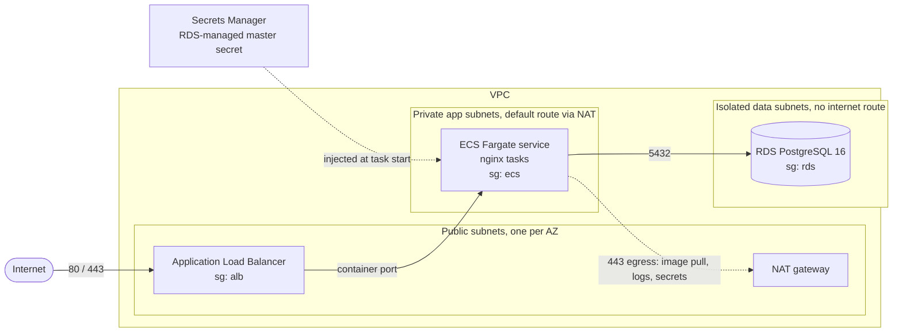

# DevOps Assessment: Terraform + Database Reliability

AWS infrastructure in Terraform (**Internet → ALB → ECS/Fargate → RDS PostgreSQL**) with separate
`dev` and `prod` environments, a GitHub Actions workflow that posts the `terraform plan` to the
pull request, and a local PostgreSQL setup with migrations, seed data, query indexing, and
verified backup and restore scripts.

Nothing here needs an AWS account: the Terraform can be planned offline, and all the database
work runs in Docker.

> **Running Terraform without AWS?** Each environment uses an S3 backend, so a plain
> `terraform init` needs AWS credentials and the state bucket. Without them, run
> `terraform init -backend=false && terraform validate` in `infra/envs/dev` or `infra/envs/prod`,
> or `./scripts/tf-plan.sh dev --offline` for the full fmt, init, validate and `plan -refresh=false`
> run. Details are in [Reviewing Terraform](#reviewing-terraform).

---

## Quick start

**Prerequisites:** Docker with the Compose v2 plugin, and Terraform ≥ 1.10. Run the scripts from
bash on Linux, macOS or WSL.

```bash
# Database (Parts 4-6)
docker compose up -d --wait      # PostgreSQL 16, migrations and seed applied automatically
./scripts/backup.sh              # timestamped dump in ./backups (+ .sha256 + .manifest)
./scripts/restore.sh             # restore into a fresh database and verify every table

# Terraform (Parts 1-2), no AWS account needed
./scripts/tf-plan.sh dev  --offline   # fmt -check, init, validate, plan -refresh=false
./scripts/tf-plan.sh prod --offline
```

Expected results:

| Command | Result |
|---|---|
| `docker compose up -d --wait` | `Container hotel-bookings-db-1 Healthy` (1,200 bookings, 2,840 events) |
| `./scripts/backup.sh` | `backup OK: backups/bookings_<UTC timestamp>.dump` |
| `./scripts/restore.sh` | every table `OK (md5 match)`, then `restore verified` and exit code 0 |
| `tf-plan.sh dev --offline` | `Plan: 52 to add, 0 to change, 0 to destroy.` |
| `tf-plan.sh prod --offline` | `Plan: 70 to add, 0 to change, 0 to destroy.` |

A plain `docker compose up` (without `-d`) works too. Run the scripts from a second terminal.

Plain `terraform init` uses each environment's S3 backend, so it needs AWS credentials and the
state bucket (created once by `infra/bootstrap`). Without an AWS account, use the `--offline` script
above, or `terraform init -backend=false && terraform validate`. The full steps for both are in
[Reviewing Terraform](#reviewing-terraform).

---

## Repository layout

```
.
├── infra/
│   ├── bootstrap/          one-time stack that creates the S3 state buckets
│   ├── modules/
│   │   ├── network/        VPC, public, private and isolated data subnets, IGW, NAT, routes, flow logs
│   │   ├── ecs/            ALB + ECS security groups, ALB, ECS cluster, task definition, service, autoscaling, IAM
│   │   └── rds/            RDS security group, subnet group, parameter group, PostgreSQL instance
│   └── envs/
│       ├── dev/            backend.tf, providers.tf, versions.tf, main.tf, variables.tf, terraform.tfvars, outputs.tf
│       └── prod/           same files, own state bucket, own sizing, stricter variable validation
├── .github/workflows/
│   ├── terraform-plan.yml  Part 3: fmt, init, validate, plan on PRs; posts the plan as a PR comment, summary and artifact
│   └── database.yml        CI for compose up, backup, restore and EXPLAIN
├── docker-compose.yml      PostgreSQL 16 (db) + empty restore target server (restore-db, opt-in)
├── db/
│   ├── migrations/         0001 tables, 0002 index for the Delhi query
│   ├── seed/               deterministic, idempotent seed (1,200 bookings + events)
│   ├── initdb/             first-boot hook: runs migrate.sh with seeding
│   └── migrate.sh          small migration runner with a schema_migrations table
├── scripts/
│   ├── backup.sh           Part 6: timestamped, consistent, checksummed dump with retention
│   ├── restore.sh          Part 6: restore into a fresh database or server, then verify
│   ├── migrate.sh          apply new migrations to a running database
│   ├── explain.sh          EXPLAIN ANALYZE the Delhi query with and without the index
│   ├── bulk-load.sh        optional: add 1M rows for a realistic EXPLAIN
│   └── tf-plan.sh          fmt, init, validate, plan for one environment (online or --offline)
└── Makefile                short aliases for all of the above (`make help`)
```

---

## Part 1: Infrastructure design



### Network (`modules/network`)
* One VPC with **three subnet tiers** in every AZ, each a `/20` carved from the VPC `/16` by `cidrsubnet()`:
  * **public**: ALB and NAT gateways, with a default route to the Internet Gateway.
  * **private**: Fargate tasks, outbound only through NAT.
  * **data**: RDS, with a route table that has **no default route**. Even a misconfigured security group cannot give the database internet access.
* NAT: one shared gateway in dev (`single_nat_gateway = true`, cheaper) and one per AZ in prod, so losing an AZ doesn't cut egress for the other AZs.
* The default security group is taken over and left with no rules, so nothing can use it by accident.
* VPC Flow Logs go to CloudWatch (enabled in prod).

### Security groups: least privilege, rules reference other groups
| Group | Inbound | Outbound |
|---|---|---|
| **alb** | 80 (and 443 when a certificate is set) from `allowed_ingress_cidrs` | container port **to the ecs group only** |
| **ecs** | container port **from the alb group only** | 443 to the internet (image pull, logs, Secrets Manager); 5432 to the data subnets only |
| **rds** | 5432 **from the ecs group only** | none |

**The RDS instance is private:** it sits in the data subnets, has `publicly_accessible = false`,
and its only inbound rule references the ECS task security group. Rules are separate
`aws_vpc_security_group_*_rule` resources (the current AWS provider practice), which avoids the
ALB↔ECS circular dependency.

### ECS (`modules/ecs`)
* An ECS cluster with Container Insights, using FARGATE and FARGATE_SPOT capacity providers (dev runs on Spot).
* Task definition: placeholder `nginx` image from ECR Public, `awsvpc` networking, logs to CloudWatch through `awslogs`.
  DB host, port and name are passed as environment variables. **The DB username and password are injected from the RDS-managed Secrets Manager secret**,
  so no credentials appear in Terraform code, state or the task definition.
* Two IAM roles: the execution role (pull image, write logs, read that one secret) and an empty task role, plus ECS Exec permissions only when that is enabled.
* The service runs in private subnets with no public IP, behind the ALB target group (`ip` target type). It has a **deployment circuit breaker with automatic rollback**,
  and min 100% / max 200% healthy during deploys.
* Target-tracking autoscaling on CPU. `desired_count` is ignored after creation so Terraform doesn't fight the autoscaler.
* ALB: drops invalid headers and has optional access logs. When `certificate_arn` is set it adds an HTTPS listener (TLS 1.3 policy) and HTTP redirects to HTTPS.

### RDS (`modules/rds`)
* PostgreSQL 16 on gp3 storage with storage autoscaling, **encrypted at rest** (a KMS CMK is optional), and **TLS enforced** (`rds.force_ssl = 1`).
* `manage_master_user_password = true`: RDS generates and rotates the password in Secrets Manager. IAM DB auth is enabled.
* Backup retention, backup and maintenance windows, deletion protection, final snapshot, Multi-AZ, Performance Insights and Enhanced Monitoring are all set per environment.
* A parameter group adds `pg_stat_statements`, slow query logging and lock wait logging. PostgreSQL logs are exported to CloudWatch.

---

## Part 2: Environments

Each environment is its own root module with its **own variables, tfvars, backend and state**.
Both reuse the same three modules, so dev and prod can differ only in size and settings, never in
architecture.

| Setting | dev | prod |
|---|---|---|
| State backend | `s3://hotel-bookings-tfstate-dev/hotel-bookings/dev/terraform.tfstate` | `s3://hotel-bookings-tfstate-prod/hotel-bookings/prod/terraform.tfstate` |
| State locking | S3 native lock file (`use_lockfile`) | S3 native lock file (`use_lockfile`) |
| VPC / AZs | `10.10.0.0/16`, 2 AZs | `10.20.0.0/16`, 3 AZs |
| NAT gateways | 1 (shared) | 3 (one per AZ) |
| Fargate task | 0.25 vCPU / 512 MiB, **Spot** | 1 vCPU / 2 GiB, on-demand |
| Tasks (desired / min / max) | 1 / 1 / 2 | 3 / 3 / 10 |
| **RDS instance** | `db.t4g.micro` | `db.r6g.large` |
| Storage (initial / max) | 20 / 50 GiB | 100 / 500 GiB |
| Multi-AZ | false | **true** |
| **Backup retention** | **1 day** | **30 days** |
| **Deletion protection** | **false** (RDS and ALB) | **true** (RDS and ALB) |
| Final snapshot on delete | skipped | taken |
| Performance Insights / Enhanced Monitoring | off / off | on / 60 s |
| Log retention | 7 days | 90 days |
| Flow logs | off | on |

**Guardrails:** `envs/prod/variables.tf` has validation rules, so `terraform plan` **fails** if
someone sets prod `db_deletion_protection = false`, a backup retention under 7 days,
`db_multi_az = false`, `db_skip_final_snapshot = true` or Fargate Spot. Each root module also
checks that its `environment` value matches its folder, which stops dev tfvars from being applied
to prod.

The provider lock file (`.terraform.lock.hcl`) is committed in each environment, with checksums
for Linux, macOS (Intel and Apple Silicon) and Windows. Every machine therefore installs the same
AWS provider build (6.70.0).

---

## Reviewing Terraform

### Without an AWS account (offline)

`terraform init` against the S3 backend and a normal `terraform plan` both need AWS credentials.
For review, the environments support an **offline mode**:

* A temporary `backend_override.tf` swaps the S3 backend for a local one. Terraform's
  [override files](https://developer.hashicorp.com/terraform/language/files/override) replace the
  backend block, and the file is gitignored.
* `-var offline_plan=true` gives the AWS provider dummy credentials and turns off the STS and
  metadata calls. Nothing in the configuration uses AWS data sources (AZs are passed as
  variables), so `plan -refresh=false` makes **no AWS API calls at all**.

`./scripts/tf-plan.sh <env> --offline` does all of this and deletes the override afterwards. To
run the same steps by hand:

```bash
cd infra/envs/dev                     # or prod
terraform fmt -check -recursive ../..

cat > backend_override.tf <<'EOF'
terraform {
  backend "local" {}
}
EOF

terraform init
terraform validate
terraform plan -refresh=false -var offline_plan=true
rm backend_override.tf
```

If you only want `init` and `validate`, `terraform init -backend=false && terraform validate` is
enough.

### With AWS credentials (real backend)

```bash
./scripts/tf-plan.sh dev     # init with S3 backend, validate, plan -refresh=false
# or by hand:
cd infra/envs/dev && terraform init && terraform validate && terraform plan -refresh=false
```

The plan is saved to `infra/envs/<env>/plan/tfplan.txt`.

### Deploying to AWS

1. **State buckets (once).** `infra/bootstrap` creates the dev and prod state buckets with versioning, encryption, public access blocked and a TLS-only policy:
   ```bash
   cd infra/bootstrap && terraform init && terraform apply
   ```
   S3 bucket names are global. If the defaults are taken, set `state_buckets` and init the env with `terraform init -backend-config="bucket=<your-bucket>"`.
2. **Apply an environment:**
   ```bash
   cd infra/envs/dev
   terraform init
   terraform apply
   curl "$(terraform output -raw alb_url)"   # nginx welcome page once the targets are healthy
   ```
   RDS takes about 10 minutes to create. The DB credentials are in the Secrets Manager secret from `terraform output rds_master_secret_arn`.
3. **Tear down:** dev destroys directly with `terraform destroy`. Prod is protected on purpose, so first set `alb_deletion_protection = false` and `db_deletion_protection = false` (and temporarily relax the matching validation in `envs/prod/variables.tf`), apply, then destroy. Prod also leaves a final RDS snapshot that has to be deleted by hand.

Cost note: prod runs a Multi-AZ `db.r6g.large` and three NAT gateways, so it costs real money per hour. Try dev first and destroy it when you're done.

---

## Part 3: Terraform plan in GitHub Actions

[`.github/workflows/terraform-plan.yml`](.github/workflows/terraform-plan.yml) runs on every pull
request that touches `infra/**`. It runs once per environment (`dev` and `prod`):

1. `terraform fmt -check -recursive`
2. `terraform init`
3. `terraform validate`
4. `terraform plan -refresh=false`

The plan is published in **all three** of the ways the brief lists:
* **PR comment**: one comment per environment, updated in place on each push (it finds its own
  comment by a hidden marker), with the plan inside a collapsible block.
* **Job summary**: the same report on the workflow run page.
* **Workflow artifact**: `tfplan-dev` and `tfplan-prod` (the plan text and the full log), kept for 14 days.

**Credentials:** if the repository variable `AWS_PLAN_ROLE_ARN` is set, the job assumes that
(read-only) role through **GitHub OIDC**, with no stored access keys, and plans against the real
S3 state. Without it, the job runs in offline mode, so it also passes on forks. If any step fails,
the comment shows ❌ with the log and the job fails.

[`.github/workflows/database.yml`](.github/workflows/database.yml) also runs the database checks
in CI: ShellCheck, `docker compose up`, seed assertions, backup, both restore modes, and EXPLAIN.

---

## Part 4: Local database

```bash
docker compose up -d --wait
```

* `postgres:16-alpine`, the same major version as RDS. It listens on `127.0.0.1:5432` (change this with `POSTGRES_PORT` in `.env`, see `.env.example`).
* On **first start** (empty volume), `db/initdb/10-migrate-and-seed.sh` runs the migration runner and then the seed.
  The healthcheck uses TCP on purpose: the server only opens TCP after initialisation finishes,
  so `--wait` returns only once the data is ready.
* `./scripts/migrate.sh` applies migrations added later. Each one is recorded in `schema_migrations` and runs in a transaction, except files marked `migrate:no-transaction` (needed for `CREATE INDEX CONCURRENTLY`).
* `docker compose down -v` deletes the data. The next `up` migrates and seeds again.

Schema ([`db/migrations/0001_create_bookings_tables.sql`](db/migrations/0001_create_bookings_tables.sql)):
the suggested tables, plus constraints that make the data trustworthy:

* `booking_events.booking_id` is a **foreign key** to `hotel_bookings(id)` with `ON DELETE CASCADE`. It is indexed on `(booking_id, created_at)`, because PostgreSQL doesn't index FKs automatically.
* `CHECK` constraints: `checkout_date > checkin_date`, `amount >= 0`, `status` must be one of the five lifecycle values, and **`city` is stored lower-case**. The last one means `WHERE city = 'delhi'` finds every Delhi booking with a plain, indexable equality, with no `lower(city)` in the query.

Open a shell with `make psql`, or `docker compose exec db psql -U bookings -d bookings`.

## Part 5: Seed data and indexing

[`db/seed/0001_seed_bookings.sql`](db/seed/0001_seed_bookings.sql) adds **1,200 bookings** across
**12 organisations**, **9 cities** (Delhi is about 20%) and **5 statuses**, plus **2,840 events**
for about 80% of the bookings. Every value is derived from hashes of the row number, so the seed
is **deterministic** (same ids every run) and **idempotent** (`ON CONFLICT DO NOTHING` / `NOT
EXISTS`). `created_at` is spread over the last 120 days **relative to `now()`**, so the 30-day
report always returns rows.

```sql
SELECT city, count(*) FROM hotel_bookings GROUP BY 1 ORDER BY 2 DESC;
SELECT status, count(*) FROM hotel_bookings GROUP BY 1;
SELECT count(DISTINCT booking_id), count(*) FROM booking_events;
```

### Query optimisation

```sql
SELECT org_id, status, COUNT(*), SUM(amount)
FROM hotel_bookings
WHERE city = 'delhi'
  AND created_at >= NOW() - INTERVAL '30 days'
GROUP BY org_id, status;
```

**Index** ([`db/migrations/0002_index_hotel_bookings_city_created_at.sql`](db/migrations/0002_index_hotel_bookings_city_created_at.sql)):

```sql
CREATE INDEX CONCURRENTLY IF NOT EXISTS idx_hotel_bookings_city_created_at
    ON hotel_bookings (city, created_at)
    INCLUDE (org_id, status, amount);
```

**Why this index:**
1. **`city` first, then `created_at`.** The rule for B-tree indexes is equality columns first, then the range column. With `(city, created_at)`, every Delhi row from the last 30 days sits in **one contiguous range** of the index. PostgreSQL seeks to `('delhi', now() - 30 days)` and reads forward until the Delhi entries end, touching nothing else. With `(created_at, city)` it would have to read the last 30 days for *every* city and filter out the non-Delhi rows.
2. **`INCLUDE (org_id, status, amount)` makes it a covering index.** Everything the query needs (the filter columns, the GROUP BY columns and the summed column) is in the index, so PostgreSQL can use an **Index Only Scan** and never read the table. INCLUDE columns are stored only in the leaf pages and are not part of the sort key, so they don't widen the inner pages.
3. **`CONCURRENTLY`** builds it without blocking writes, which is what you'd do on a live production table.

**Evidence** (`./scripts/explain.sh --compare`, which drops the index inside a transaction that is
rolled back). On the 1,200-row seed, the plan already uses the index:

```
HashAggregate (actual time=0.166..0.182 rows=38 loops=1)
  Group Key: org_id, status
  ->  Index Only Scan using idx_hotel_bookings_city_created_at on hotel_bookings (actual time=0.082..0.110 rows=58 loops=1)
        Index Cond: ((city = 'delhi'::text) AND (created_at >= (now() - '30 days'::interval)))
        Heap Fetches: 0
Execution Time: 0.307 ms           (without the index: Seq Scan, 1,142 rows removed by filter)
```

A table this small fits in a few pages, so for a realistic comparison I ran
`./scripts/bulk-load.sh` (**1,001,200 rows**, 20 cities, 2 years of history):

| Index | Plan | Buffers read | Execution time |
|---|---|---|---|
| none | Parallel Seq Scan, 999k rows filtered out | 14,547 | **82.9 ms** |
| `(created_at, city)` | Bitmap Index + Heap Scan | ~2,240 | ~7.5 ms |
| `(city, created_at)` | Bitmap Index + Heap Scan | ~2,080 | ~3.5 ms |
| **`(city, created_at) INCLUDE (org_id, status, amount)`** | **Index Only Scan, Heap Fetches: 0** | **~32** | **~2.7 ms** |

That is roughly **30x faster and about 450x fewer pages read** than with no index. The result is
2,265 matching rows in 250 groups.

**Trade-offs I considered:**
* *Write and storage cost:* the covering index is larger and every insert has to maintain it. If the table were very write-heavy, a plain `(city, created_at)` index gets most of the benefit (above) for less cost.
* *Partial index* (`WHERE city = 'delhi'`): smaller, but it only helps one hard-coded city. A report like this is normally parameterised by city.
* *BRIN on `created_at`*: very small and good for append-only time-series data, but it can't filter by city.
* *Index-only scans depend on the visibility map.* Autovacuum keeps it current. `explain.sh` runs `VACUUM (ANALYZE)` first so the plan is stable.
* *`created_at` is `TIMESTAMP`* (as the brief suggests), while `NOW()` returns `timestamptz`. PostgreSQL compares the two with a cross-type operator that is in the same B-tree operator family, so the index is still used (see `Index Cond`). In production I'd make the column `TIMESTAMPTZ` so the time zone is never ambiguous.

---

## Part 6: Backup and restore

### Backup: `./scripts/backup.sh`

```bash
./scripts/backup.sh                      # db=$POSTGRES_DB, dir=./backups, keep newest 7
./scripts/backup.sh -d bookings -o /path/to/backups -k 14
```

Creates `backups/<db>_<YYYYMMDDTHHMMSSZ>.dump` (UTC timestamp) along with:
* `.sha256`: a checksum (`cd backups && sha256sum -c <name>.sha256`).
* `.manifest`: the row count and an md5 of all rows for every table, used to verify a restore.

How it works:
* **pg_dump custom format** (`-Fc`): compressed, and it supports selective restore and `pg_restore --list`. `--no-owner --no-privileges` keep the dump portable to any server.
* **Consistent with the manifest, even under writes.** The script opens a `REPEATABLE READ` transaction, exports its snapshot (`pg_export_snapshot()`), computes the manifest inside that snapshot, and runs `pg_dump --snapshot=<id>`. The manifest therefore describes exactly what is in the dump. I tested this with 40 concurrent insert batches running during a backup: the restore matched the manifest exactly while the live table kept growing.
* Writes to a `.partial` file and renames it only after `pg_restore --list` has confirmed the archive is readable. A failed run never leaves a dump that looks valid.
* **Retention:** keeps the newest `-k` dumps for that database and deletes the older ones together with their `.sha256` and `.manifest`.
* `pg_dump` runs **inside the container**, so the client version always matches the server and the host needs only Docker.

### Restore: `./scripts/restore.sh`

```bash
./scripts/restore.sh                         # newest dump -> NEW database "bookings_restored"
./scripts/restore.sh backups/bookings_20261028T153545Z.dump
./scripts/restore.sh -t bookings_dr_drill    # choose the target database name
./scripts/restore.sh --new-server            # restore into a separate, empty PostgreSQL container
```

1. Verifies the `.sha256`. A corrupted or modified dump is rejected before anything is touched.
2. Drops and recreates the target from `template0`, so it is a **fresh, empty database**. It refuses to overwrite the live `bookings` database unless you pass `--force`.
3. Runs `pg_restore --single-transaction --exit-on-error`: **all or nothing**, never a half-restored database.
4. Runs `ANALYZE`, then **verifies automatically** by fingerprinting every table (row count plus md5 of all rows) and comparing with the manifest. Any difference exits non-zero.

`--new-server` starts the `restore-db` service, a second PostgreSQL container that keeps its data
in tmpfs and is empty every time. This proves the dump restores on a brand-new instance, not just
next to the original.

### How to verify the restore worked

**1. Read the script's output.** It ends like this and exits with code 0:

```
  Verification against manifest recorded at backup time
  table                    expected     restored  result
  booking_events               2840         2840  OK (md5 match)
  hotel_bookings               1200         1200  OK (md5 match)
  schema_migrations               2            2  OK (md5 match)

restore verified: 'bookings_restored' is identical to the backup
```

The md5 covers every column of every row, so a match means the data is identical, not just the
same size.

**2. Check by hand.** Compare the source and the restored copy:

```bash
for db in bookings bookings_restored; do
  docker compose exec -T db psql -U bookings -d "$db" -tAc "
    SELECT '$db',
           (SELECT count(*) FROM hotel_bookings),
           (SELECT count(*) FROM booking_events),
           (SELECT sum(amount) FROM hotel_bookings),
           (SELECT max(version) FROM schema_migrations)"
done
```

Both lines should be identical. (If the source received writes after the backup, it will have
more rows. The manifest comparison in step 1 is the authoritative check.)

**3. Check that schema objects came back,** including the index, the FK and the constraints, and
that the report query runs on the restored copy:

```bash
docker compose exec db psql -U bookings -d bookings_restored -c '\d hotel_bookings'
docker compose exec db psql -U bookings -d bookings_restored -c "
  SELECT org_id, status, COUNT(*), SUM(amount) FROM hotel_bookings
  WHERE city = 'delhi' AND created_at >= NOW() - INTERVAL '30 days'
  GROUP BY org_id, status ORDER BY 1, 2;"
```

**4. Negative tests I ran:** flipping one byte of the dump makes the restore stop with
`checksum mismatch`. Changing an expected value in the manifest makes it report `MISMATCH` and
exit 1.

---

## Production notes and next steps

Things I would add in a real environment but left out to keep the assessment focused:

* **Backups in AWS:** RDS automated backups and PITR are already set up per environment. Next would be AWS Backup with cross-region and cross-account copies, plus a scheduled restore drill using the same verification idea as `restore.sh`.
* **Edge:** AWS WAF on the ALB, an ACM certificate (`certificate_arn`) and Route 53 records.
* **Cost and security:** VPC interface endpoints (ECR, Logs, Secrets Manager) so task traffic doesn't go through NAT, a customer-managed KMS key (`kms_key_arn`), and ALB access logs to S3.
* **Pipeline:** `tflint`, `checkov` or `trivy config` in the plan workflow, and an apply workflow gated by GitHub Environments with required reviewers for prod.
* **State bootstrap:** a small module that creates the versioned, encrypted state buckets.

## Troubleshooting

* **Port 5432 already in use:** `cp .env.example .env`, set `POSTGRES_PORT=55432`, then run `docker compose up -d --wait` again.
* **`bad interpreter` or `\r` errors on Windows:** use WSL, or clone with `git config core.autocrlf false`. `.gitattributes` already forces LF endings.
* **Start over from scratch:** `make reset` (which runs `docker compose --profile restore down -v`), then `docker compose up -d --wait`.
